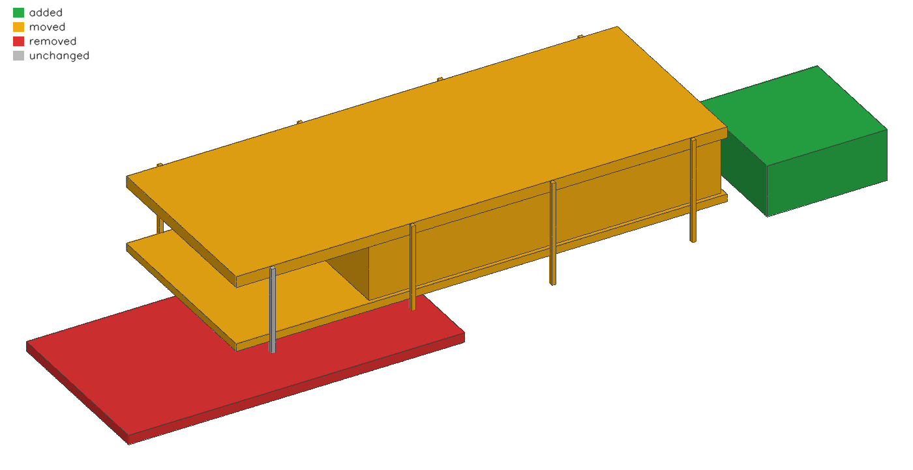

# paramgraph

A building as a parameter graph in plain text. The model is data, not code:
named parameters with a grade saying where each number came from, rules
derived from them, boxes whose coordinates are expressions, and checks
against independent sources. Being text, it versions in git; being a graph,
a diff can say which parameter moved which element.

```text
model "Farnsworth House"
param s = 6.706 P "column bay, 22'-0\" (HABS sheet 3)"
param c = 1.752 D "west cantilever, from the photo"
let L = 2*c + 3*s "two cantilevers and three bays"
box floor_slab D: x 0 .. L, y 0 .. W, z zf_b .. zf_t
box col_S[i in 0..2] D: x c + i*s - col/2 .. c + i*s + col/2, y -col .. 0, z 0 .. zr_t
check L = 23.57 tol 0.707 "HABS: 77'-4 1/8\""
```

Grades: **P** drawing or published dimension, **D** measured from a photo,
**I** inferred by a rule (every `let`), **A** assumed.

## Commands

```
pg eval  MODEL              parameters, rules, elements and checks
pg check MODEL              checks only; exit code 1 if any fails (for CI)
pg deps  MODEL [NAME]       what each parameter feeds, or what NAME depends on
pg diff  OLD NEW [--color]  design changes between two versions
pg obj   MODEL OUT.obj      boxes grouped by grade, for Rhino or Blender
pg diff-obj OLD NEW OUT.obj added / removed / moved / unchanged groups
pg merge BASE OURS THEIRS [OUT]  three-way merge; exit code 1 on any conflict
```

`pg diff examples/farnsworth.pg examples/farnsworth_edit.pg`:

```
parameters
  ~ s  6.706 -> 7.01 (+0.304)
  ~ W  8.993 -> 9.5 (+0.507), grade D -> A
elements
  ~ col_S[1]  moved up to 0.304 m because of s
  ~ floor_slab  moved up to 0.912 m because of W, s
  - terrace  x -7.063..9.737, y -2.920..5.938, z 0.429..0.907
  + carport  x 26.534..32.534, y 0.000..6.000, z 0.000..2.600
checks
  ~ W  9.500 vs 8.738 : pass -> FAIL
  ~ L  24.534 vs 23.57 : pass -> FAIL
```

`pg diff-obj` writes the same change as geometry, and `tools/preview.py`
(Python, OpenCV) draws it without a CAD program; the `.3dm` next to it has the
four groups as coloured Rhino layers:



## Merge, and git as the review gate

`pg merge BASE OURS THEIRS [OUT]` merges statement by statement (a parameter
by name, a box by id), so moved lines are not changes, and keeps ours' layout.
On top of text conflicts it reports **design conflicts**: an element that
depends on a change from each side. Example: on `main` the bays go to 6.9 m,
on the `agent` branch the glass is set back to 0.45 m. The lines are far
apart, so plain git merges silently; but the glass wall depends on both, and
nobody has looked at that combination. Checks that pass on each side and fail
after the merge are reported the same way.

Use it as git's merge driver for model files:

```
git config merge.paramgraph.name "paramgraph three-way merge"
git config merge.paramgraph.driver "pg merge %O %A %B %A"
echo '*.pg merge=paramgraph' >> .gitattributes
```

```
$ git merge agent
design conflicts
  box glass: ours changed s, theirs changed g_y; the combination was never seen by either side
taken from theirs: param g_y
CONFLICT (content): Merge conflict in house.pg
```

To see it happen: `bash examples/git-demo.sh path/to/pg.exe` builds a throwaway repository, edits the house on two branches and merges them with and without the driver.

The merged file is already in the working tree; `pg diff` and `pg diff-obj`
show the reviewer what it does, and `git add` accepts it.

## A self-hosted git server

Any git host the office runs itself works (GitLab CE, Gitea, Forgejo); no
special server is needed. `ci/README.md` sets up the workstation side (merge
and diff drivers) and `ci/gitlab-ci.yml` the server side: every merge request
that touches a model gets its checks, a design diff with a red/green picture
and a dry-run merge against the target, and fails if any of them does. A
server's merge button uses plain git, so this CI job, with "pipelines must
succeed", is what makes review before merge enforceable.

## Where the models come from

[reverse-cad](https://github.com/vibecading/reverse-cad) recovers parametric
models of real buildings from photos and checks them against measured
drawings; its `tools/to_pg.py` writes them in this format.
`examples/robie_w1.pg` (one photo) and `examples/robie_joint.pg` (two photos)
come from there: `pg diff` between them shows five drawing checks going from
FAIL to pass.

## Build

Rust stable, no dependencies: `cargo test`, `cargo build --release`.

## Licence

MIT, see [LICENSE](LICENSE).

## Status

A working core for the format, evaluation, the dependency graph, checks,
semantic and geometric diff, three-way merge with design conflicts, a git
merge driver and OBJ export. Not yet: geometry beyond boxes, import from the
photo-solve specs, a viewer.
